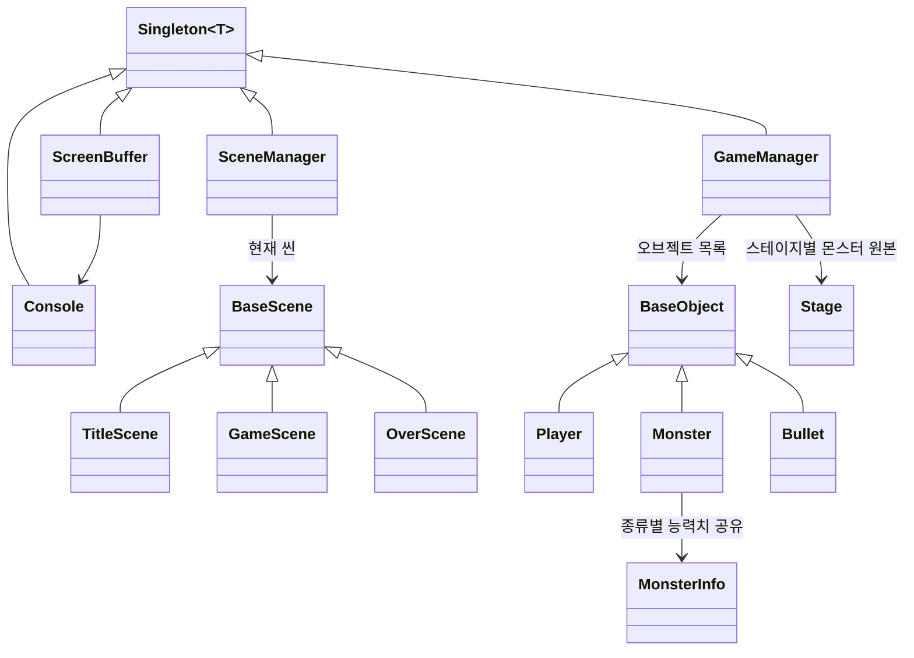

# OOPShootingGame

게임의 모든 요소를 역할별 클래스로 나눈 "극단적 객체지향" 방식의 콘솔 텍스트 슈팅 게임이다.

## 소개

- Windows 콘솔에 문자로 그리는 슈팅 게임이다. 화면 아래쪽의 플레이어가 위쪽 몬스터 편대를 쏘아 모두 없애면 다음 스테이지로 넘어간다.
- 장면(Scene), 게임 오브젝트, 매니저, 화면 버퍼, 자료구조까지 역할마다 클래스를 나누고 상속, 가상 함수, 템플릿으로 연결하는 데 초점을 두었다.
- 스테이지 배치, 몬스터와 플레이어 능력치, 이동 패턴을 모두 텍스트 파일로 분리해 코드를 고치지 않고 게임 내용을 바꿀 수 있다.
- 리스트 컨테이너도 STL 대신 직접 구현한 `List<T>`를 사용한다.

## 주요 기능

- 타이틀 메뉴: `Start Game` / `Endless Mode` / `Exit Game` (방향키 ↑ / ↓로 고르고 `SPACE`로 선택)
- 스테이지 3개. 마지막 스테이지에는 보스 몬스터가 나온다.
- 무한 모드: 모든 스테이지를 끝내면 1스테이지부터 다시 시작하고, 회차가 늘 때마다 몬스터 능력치가 올라간다.
- 결과 화면: 클리어하면 `GAME CLEAR`, 플레이어가 죽으면 `GAME OVER`를 아스키 아트로 띄우고 `Title Menu` / `Exit Game`을 고른다.
- 화면 첫 줄에 플레이어 HP를 `#` 개수로 표시한다.

| 키 | 동작 |
|----|------|
| 방향키 | 플레이어 이동 |
| `A` | 일반 공격 |
| `S` | 특수 공격 (공격력 3배, 5칸 범위, 맞은 적 총알도 함께 제거, 쿨타임 있음) |
| `ESC` | 게임 즉시 종료 |

| 몬스터 | 외형 | 크기 |
|--------|------|------|
| `a` | `#` | 1칸 |
| `b` | `@` | 가로 3칸 |
| `c` | `Y` | V자 3칸 |
| `k` (보스) | `$` | 3줄, 최대 가로 9칸. 총알도 여러 칸으로 날아온다 |

## 핵심 구현

### 클래스 구조



| 클래스 | 역할 |
|--------|------|
| [`Singleton<T>`](OOPShootingGame/OOPShootingGame/Singleton.h) | 생성자를 `protected`로 막고 `static inline` 멤버에 인스턴스 하나만 두어 `GetInstance()` / `DestroyInstance()`로 관리하는 템플릿 |
| [`SceneManager`](OOPShootingGame/OOPShootingGame/SceneManager.cpp) | 게임 루프를 돌리며 씬을 교체 |
| [`GameManager`](OOPShootingGame/OOPShootingGame/GameManager.cpp) | 데이터 파일 로드, 오브젝트 갱신과 렌더, 충돌 판정, 삭제, 스테이지 진행 |
| [`ScreenBuffer`](OOPShootingGame/OOPShootingGame/ScreenBuffer.cpp) / [`Console`](OOPShootingGame/OOPShootingGame/Console.cpp) | 콘솔 크기만큼의 2차원 문자 버퍼, 커서 이동과 출력 |
| [`BaseScene`](OOPShootingGame/OOPShootingGame/BaseScene.h) | 씬 인터페이스 (`Update()`, `NextScene()`, `getScene()`) |
| [`BaseObject`](OOPShootingGame/OOPShootingGame/BaseObject.h) | 게임 오브젝트의 추상 클래스 (`Update()`, `Render()` 순수 가상 함수) |
| [`Player`](OOPShootingGame/OOPShootingGame/Player.cpp) / [`Monster`](OOPShootingGame/OOPShootingGame/Monster.cpp) / [`Bullet`](OOPShootingGame/OOPShootingGame/Bullet.cpp) | 실제 오브젝트. 각자 이동, 공격, 그리기를 처리 |
| [`MonsterInfo`](OOPShootingGame/OOPShootingGame/MonsterInfo.cpp) | 몬스터 종류별 능력치와 이동 패턴. 종류당 하나만 만들어 같은 종류의 `Monster`가 공유 |
| [`Stage`](OOPShootingGame/OOPShootingGame/Stage.cpp) | 스테이지별 몬스터 원본 목록 |
| [`Title`](OOPShootingGame/OOPShootingGame/Title.cpp) / [`Over`](OOPShootingGame/OOPShootingGame/Over.cpp) / [`Selector`](OOPShootingGame/OOPShootingGame/Selector.cpp) | 타이틀·결과 화면과 깜빡이는 메뉴 선택 화살표 |
| [`List<T>`](OOPShootingGame/OOPShootingGame/MyList.h) / [`Position`](OOPShootingGame/OOPShootingGame/Position.cpp) | 직접 구현한 이중 연결 리스트, 좌표와 좌표 비교 |

### 씬 전환

- `SceneManager::run()`은 매 루프마다 현재 씬의 `NextScene()`과 `getScene()`을 비교해, 다르면 기존 씬을 `delete`하고 새 씬 객체를 만든다.
- 결과 화면(`OverScene`)으로 넘어갈 때 `GameManager`를 파괴한다. 다시 시작하면 `GameManager`가 새로 만들어지고 데이터 파일부터 다시 읽는다.

### 오브젝트 다형성과 생명주기

- `GameManager`는 플레이어, 몬스터, 총알을 모두 `List<BaseObject*>` 하나에 담고 `Update()` → 충돌 판정 → 삭제 → `Render()` 순서로 같은 방식으로 처리한다.
- 오브젝트 종류는 [`HeaderSet.h`](OOPShootingGame/OOPShootingGame/HeaderSet.h)의 상수(`PLAYER_OBJECT`, `MONSTER_OBJECT`, `BULLET_OBJECT` 등)로 구분하고, 필요할 때만 `dynamic_cast`로 실제 타입에 접근한다.
- 죽은 오브젝트는 `_isDeath` 플래그만 세워 두고 `Erase()`에서 한꺼번에 지운다. 순회 도중 리스트 원소가 지워지는 문제를 피하기 위해서다. 남은 몬스터 수가 0이 되면 스테이지 클리어로 처리한다.

### 충돌 판정

- 새 총알은 리스트 앞쪽(`push_front`), 플레이어는 뒤쪽(`push_back`)에 넣는다. 이중 루프에서 앞쪽 오브젝트가 총알일 때만 판정해 플레이어와 몬스터끼리의 불필요한 비교를 건너뛴다.
- 여러 칸을 차지하는 몬스터와 총알은 차지한 좌표를 모두 `_pos`(`List<Position*>`)에 담아 두고 칸 단위로 비교한다.
- 판정 조합: 몬스터 총알과 플레이어, 플레이어 총알과 몬스터, 플레이어 특수 공격과 적 총알

### 데이터 기반 설정

게임 내용은 모두 실행 폴더의 텍스트 파일에서 읽는다. UTF-16 LE 파일을 `CreateFileW` / `ReadFile`로 읽고 맨 앞 BOM 한 글자를 건너뛴 뒤 `wcstok_s`로 줄 단위로 나눈다.

| 파일 | 내용 |
|------|------|
| `stageInfo.txt` | 스테이지 수와 스테이지 파일 목록 |
| `stage1.txt` ~ `stage3.txt` | 등장 몬스터 종류와 배치도. 배치도의 문자 위치가 화면 위치가 되고, 가로는 화면 가운데로 맞춘다 |
| `a.txt`, `b.txt`, `c.txt`, `k.txt` | 몬스터 외형, 총알 문자, HP, 공격력, 공격 주기와 무작위 가중치, 이동 주기, 이동 패턴 파일, 총알 이동 주기 |
| `move1.txt` ~ `move4.txt` | `L` / `R` / `U` / `D`로 적은 이동 패턴. 끝까지 가면 처음부터 반복 |
| `player.txt` | 플레이어 외형, 총알 문자, HP, 공격력, 공격·이동 주기, 총알 이동 주기, 특수 공격 관련 값 |

- `Stage`는 원본 `Monster`를 보관하고, 스테이지가 시작될 때 복사본을 만들어 오브젝트 목록에 넣는다. 무한 모드에서 같은 스테이지를 다시 쓸 수 있는 이유다.
- 무한 모드에서는 한 바퀴 돌 때마다 `MonsterInfo::EndlessInfoSet()`이 몬스터 HP를 올리고, 공격력에 따라 공격력을 올리거나 공격 주기를 줄인다.

### 직접 구현한 리스트: `List<T>`

- 더미 head / tail 노드를 둔 이중 연결 리스트다.
- 전위·후위 `++` / `--`, `*`, `->`, `==` / `!=`를 지원하는 `iterator`를 제공하고, `erase()`는 지운 노드의 다음 이터레이터를 돌려준다.
- `push_front`, `push_back`, `pop_front`, `pop_back`, `clear`, `remove`를 구현했다.

### 프레임 제어와 렌더링

- 초당 50프레임(1프레임 20ms)을 목표로, 로직과 렌더링이 끝난 뒤 남은 시간만큼 `Sleep()`한다. `timeBeginPeriod(1)`로 타이머 해상도를 1ms로 맞춘다.
- 직전 프레임 처리에 40ms 이상 걸렸으면 이번 프레임은 렌더링을 건너뛴다(`FrameSkip()`).
- 매 프레임 `ScreenBuffer`를 공백으로 지우고 각 오브젝트가 자기 문자를 버퍼에 쓴 뒤, `Flip()`이 줄마다 커서를 옮겨 버퍼를 출력한다.

## 기술 스택

- 언어: C++17 (상속, 가상 함수, 클래스 템플릿, `inline` 정적 멤버 변수)
- 플랫폼: Windows 콘솔, Win32 API (`GetAsyncKeyState`, `SetConsoleCursorPosition`, `CreateFileW` / `ReadFile`, `timeGetTime`)
- 개발 환경: Visual Studio 2022 (플랫폼 도구 집합 v143)

## 프로젝트 구조

```
OOPShootingGame/
├── OOPShootingGame.sln
└── OOPShootingGame/
    ├── OOPShootingGame.cpp            # 진입점: SceneManager 루프
    ├── Singleton.h                    # 싱글톤 템플릿
    ├── SceneManager.*                 # 씬 교체
    ├── BaseScene.h                    # 씬 인터페이스
    ├── TitleScene.* / Title.*         # 타이틀 화면
    ├── GameScene.*                    # 게임 화면, 프레임 제어
    ├── OverScene.* / Over.*           # 결과 화면
    ├── Selector.*                     # 메뉴 선택 화살표
    ├── GameManager.*                  # 오브젝트·스테이지·충돌 관리
    ├── BaseObject.*                   # 오브젝트 추상 클래스
    ├── Player.* / Monster.* / Bullet.*
    ├── MonsterInfo.* / Stage.*        # 몬스터 능력치, 스테이지 구성
    ├── ScreenBuffer.* / Console.*     # 화면 버퍼, 콘솔 출력
    ├── MyList.h                       # 이중 연결 리스트
    ├── Position.*                     # 좌표
    ├── HeaderSet.h                    # 오브젝트 종류 상수
    └── *.txt                          # 스테이지, 몬스터, 이동 패턴, 플레이어 데이터
```

`stage1Test.txt` ~ `stage3Test.txt`는 몬스터 한 마리만 배치한 시험용 스테이지 파일로, `stageInfo.txt`가 가리키는 파일을 바꾸면 사용할 수 있다.

## 빌드 및 실행

1. Visual Studio 2022에서 `OOPShootingGame/OOPShootingGame.sln`을 연다. "C++를 사용한 데스크톱 개발" 워크로드가 필요하다.
2. 구성(`Debug` / `Release`)을 고르고 플랫폼은 `x64`로 빌드한다. C++17(`/std:c++17`)은 x64 구성에만 지정되어 있어, `x86` 구성으로 빌드하려면 해당 구성의 C++ 언어 표준도 C++17로 바꿔야 한다.
   - 명령줄 빌드: `msbuild OOPShootingGame/OOPShootingGame.sln /p:Configuration=Release /p:Platform=x64`
3. 데이터 파일(`*.txt`)을 현재 작업 디렉터리 기준 상대 경로로 읽는다. Visual Studio에서 실행하면(기본 작업 디렉터리가 프로젝트 폴더) 그대로 동작하고, 실행 파일을 직접 실행할 때는 `OOPShootingGame/OOPShootingGame/` 폴더에서 실행한다.
4. 시작할 때 콘솔 창 크기를 읽어 화면 버퍼 크기를 정하므로, 콘솔 창을 작게 줄인 상태로 실행하지 않는다.

## 개발 기간

- 2024-11-12 (저장소 등록, 같은 날 커밋 2개)
- 1인 개인 프로젝트
